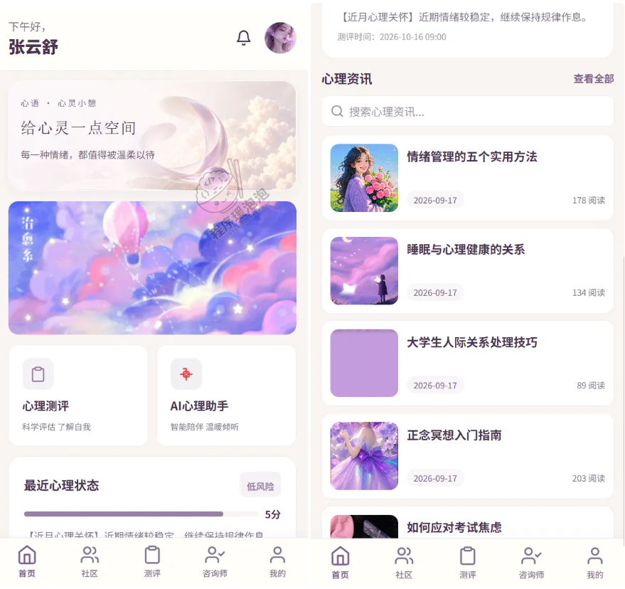
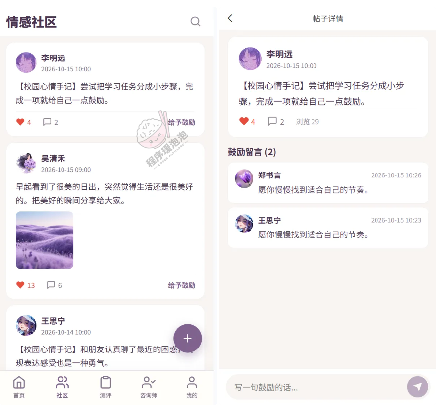
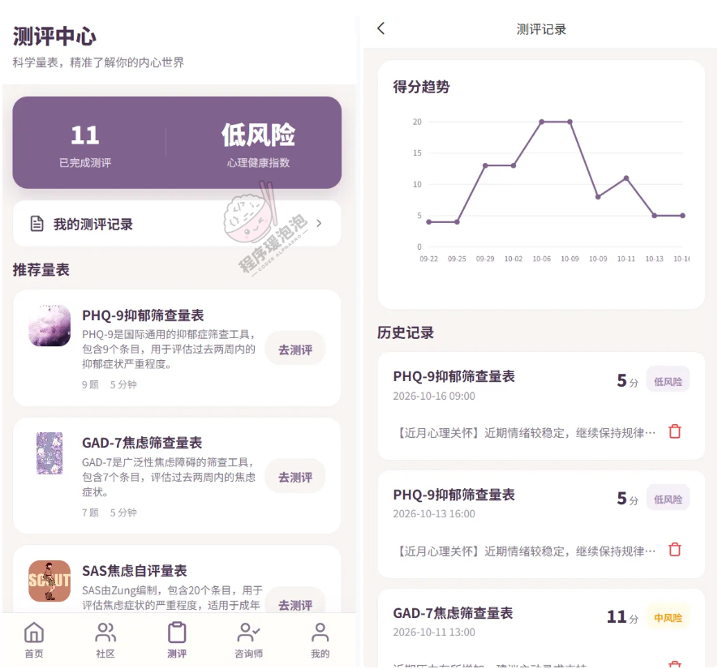
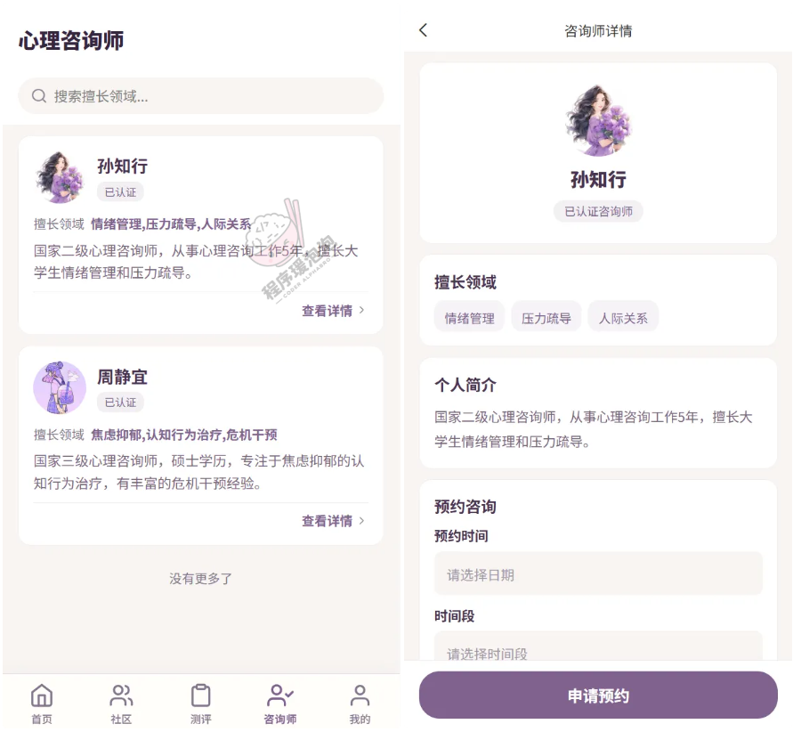
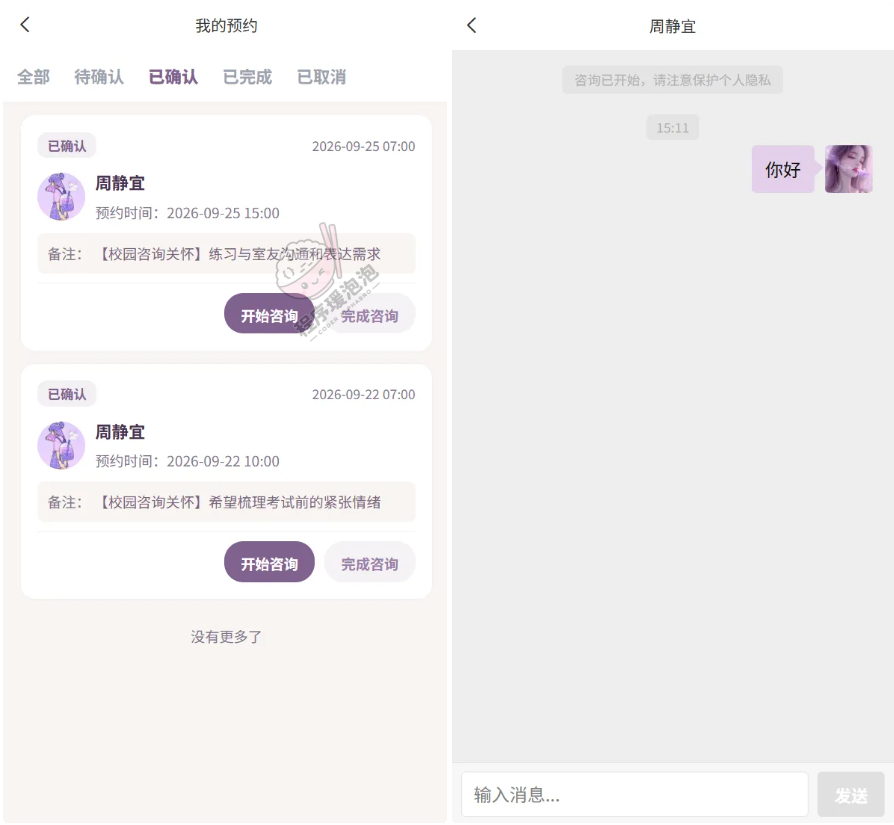
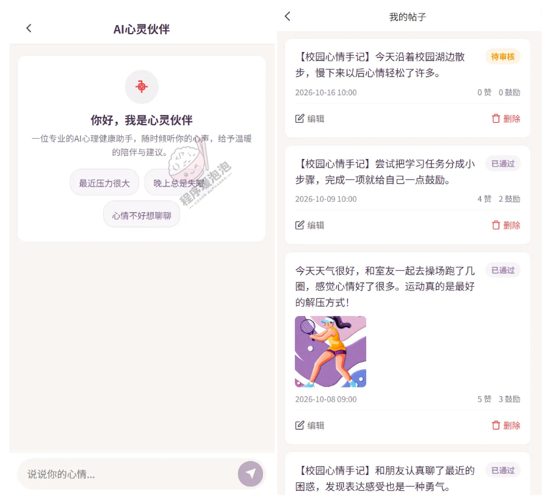
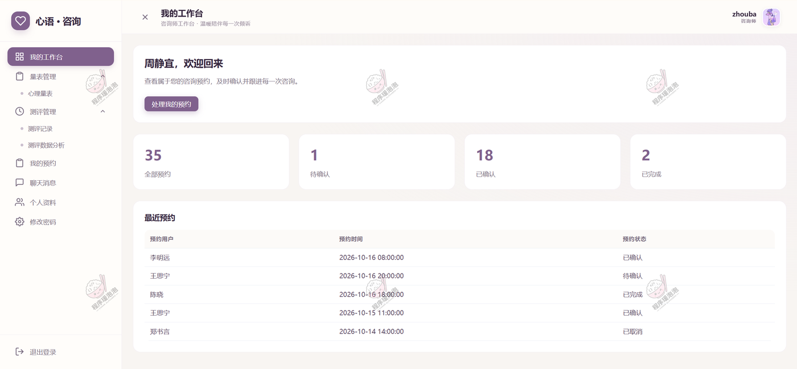
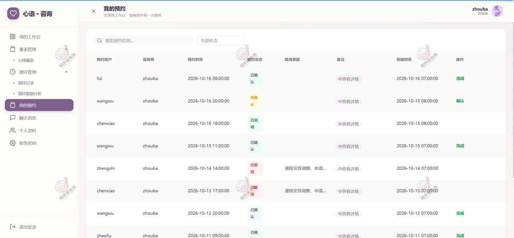
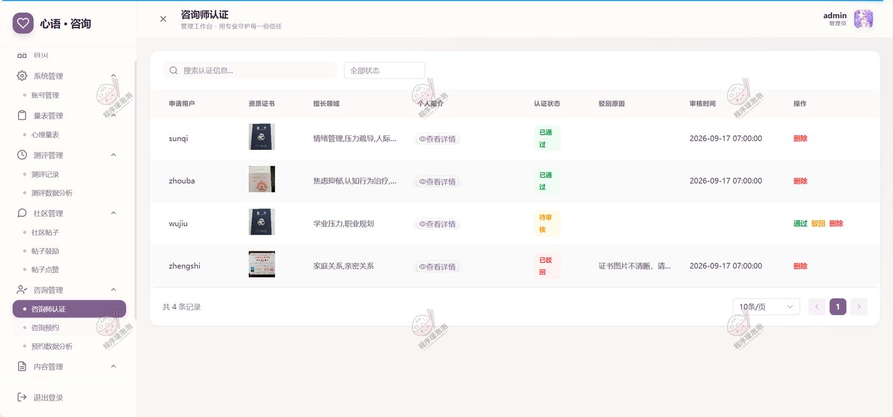
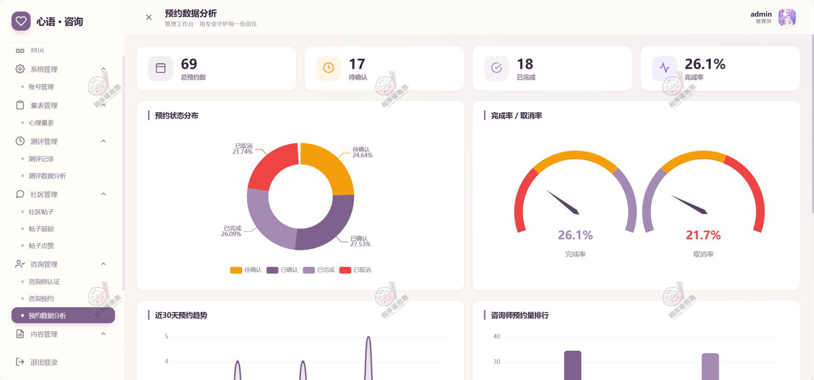

# PsychologicalConsultationUniapp
心理咨询小程序
亮点：AI流式交流、WebSocket咨询、ECharts数据可视化、心理测评闭环、 有温度的社区互动； 
角色：用户、心理咨询师、管理员； 
数据库：21张；
 
所有源码均本人开发，项目是前后端分离的，所有的项目都具备了完整的业务逻辑，不仅仅局限于基础的增删改查（CRUD）操作，系统亮点众多。

本文注重于计算机毕业设计选题指导，列出题目均有源码， 大家可以去【公众号】(毕业终点站)获取或者加我【qq】(2112698948)提意见(别忘记Star哟)。备注：git

声明：仅用于学习使用，请勿用于任何商业行为！

1.系统非商用，非开源，非无偿。

2.由本人开发，如需源码，请联系以下方式，qq:2112698948。 个人网站：https://home.biyecode.com

3.项目有很多，并未全部上传，如果未找到想要的，可直接咨询。

# 心理咨询小程序

> 基于 Spring Boot 3 + uni-app + DeepSeek 的心理咨询平台，微信小程序端 + 管理后台，支持用户、咨询师、管理员三种角色。
> 把流式 AI 陪伴、量表测评、咨询师预约和社区互助放到一起，让情绪有地方安放，也能得到回应。

## 一、项目简介

这是一套面向校园的心理咨询应用。用户在小程序里做量表测评、找 AI 心灵伙伴倾诉、预约咨询师并在线咨询，还能在情感社区发帖互助；咨询师在专属工作台处理预约和聊天；管理员在后台审核资质与帖子、维护内容、看数据分析。

系统里几个花心思的地方：

- **AI 流式交流**：后端接入 DeepSeek，结合多轮对话上下文逐段返回内容，对倾诉中的危机关键词给出风险提示。
- **WebSocket 咨询**：咨询师提交资质、管理员审核、用户预约、咨询师确认，再通过 WebSocket 实时文字沟通完成咨询，预约与聊天记录关联保存。
- **ECharts 数据可视化**：首页、测评和预约三个统计页面展示风险分布、近 30 天趋势、量表使用排行、咨询师预约排行及预约时段分布，方便观察系统使用情况。
- **从量表到报告的测评流程**：从量表、维度、题目和分值维护，到用户作答、自动计分、报告展示与历史记录查询，把心理状态自评的各个环节串起来。
- **有温度的社区互动**：图文帖子先审核后展示，结合点赞、鼓励与消息通知，让情绪分享能够得到回应。

## 二、技术栈

| 分层 | 技术 |
|---|---|
| 架构 | MVC、前后端分离，微信小程序端 + 管理后台，用户 / 咨询师 / 管理员三角色 |
| 后端 | Java、Spring Boot 3、Spring MVC、MyBatis-Plus、MySQL、JWT、WebSocket、SSE、DeepSeek 接口 |
| 后台 | Vue 3、Vite、Element Plus、Vue Router、Pinia、Axios、ECharts、SCSS |
| 小程序 | uni-app、Vue 3、Pinia、微信小程序 API、uni-ui 组件 |
| 环境 | Windows / IDEA / JDK 17 / Maven / MySQL / Node.js / 微信开发者工具 |

## 三、系统功能

### 3.1 用户端
- 账号与个人中心：注册登录、修改资料和密码、微信绑定与解绑、退出登录
- 心理首页：轮播图、心理资讯、最近测评概览，进入测评与 AI 心理助手
- 在线心理测评：选择量表、逐题作答、查看测评报告、维度得分与历史得分趋势
- AI 心理助手：输入问题或倾诉内容，查看流式回复和关键词风险提示
- 情感支持社区：检索帖子、发布图文、点赞或取消点赞、发送鼓励、查看我的帖子
- 心理资讯与放松资源：浏览和收藏科普文章，播放冥想音乐、呼吸训练等音频资源
- 咨询预约：查看咨询师介绍与擅长领域、提交预约、查看详情、取消预约、在线文字咨询
- 个人记录：查看我的测评、预约、收藏和通知消息，支持个人业务数据清理

### 3.2 咨询师端
- 咨询师认证：上传资质图片，填写擅长领域与个人简介，查看审核状态及驳回原因
- 专属工作台：查看预约概览、近期咨询安排和个人资料
- 预约处理：按状态查看预约，确认咨询、查看详情、标记咨询完成
- 在线咨询：通过 WebSocket 与预约用户文字沟通，查看历史聊天记录

### 3.3 管理员端
- 账号管理：用户信息维护、角色查看、密码重置、条件查询和数据导出
- 心理量表管理：维护量表介绍、测评维度、题目和选项分值，控制启用状态
- 测评记录管理：查询测评记录，查看总分、风险等级、作答明细和维度得分
- 咨询管理：审核咨询师资质，查看咨询预约、预约状态及相关记录
- 社区管理：审核帖子及驳回原因，维护帖子内容、点赞和鼓励记录
- 内容管理：维护心理资讯、轮播图、资讯收藏及冥想音乐、呼吸训练等放松资源
- 数据分析：首页数据看板、测评数据分析、预约数据分析，展示趋势、分布和排行

## 四、系统截图

以下选取 10 张代表性截图，按三个角色分别展示。源文档首图为登录入口页，未提供独立的系统总览图。小程序端截图为左右两页拼接的双屏图，按整张全宽展示。

### 4.1 用户端

**首页与心理资讯** —— 左页是心理首页，含轮播横幅、心理测评与 AI 心理助手入口、最近心理状态（低风险 5 分）；右页是心理资讯列表，可搜索并按篇查看阅读量，对应首页浏览与资讯功能。

**情感社区** —— 左页是情感社区帖子列表，可点赞、评论、给予鼓励和发布图文；右页是帖子详情与鼓励留言，帖子先审核后展示，让情绪分享得到回应。

**测评中心** —— 左页展示已完成测评次数、心理健康指数和推荐量表（PHQ-9、GAD-7、SAS 等）；右页是测评得分趋势折线图与历史记录，对应从作答到报告的测评流程。

**心理咨询师** —— 左页是按擅长领域搜索的咨询师列表，展示认证状态与简介；右页是咨询师详情，含擅长领域、个人简介和预约时间段的申请预约入口。

**我的预约与在线咨询** —— 左页按待确认、已确认、已完成、已取消查看预约，可开始咨询或完成咨询；右页是与咨询师的 WebSocket 实时聊天界面，对应预约与沟通的关联保存。

**AI 心灵伙伴** —— 左页是 AI 心理助手，可输入倾诉内容或点击快捷话题，流式接收回复并对危机关键词提示风险；右页是"我的帖子"，展示待审核和已通过状态，可编辑删除。

### 4.2 咨询师端

**专属工作台** —— 展示咨询师欢迎信息、全部预约 / 待确认 / 已确认 / 已完成数量和最近预约列表，是咨询师处理业务的入口。

**我的预约** —— 咨询师按预约状态查看用户预约，可查看详情、确认咨询或标记完成，对应预约处理与咨询流程。

### 4.3 管理员端

**咨询师认证** —— 展示申请用户、资质证书、擅长领域、认证状态与驳回原因，管理员可审核通过或驳回，是 WebSocket 咨询流程里资质审核的一环。

**预约数据分析** —— 总预约数、待确认、已完成和完成率指标卡，配合预约状态分布环形图、完成率 / 取消率仪表盘、近 30 天趋势与咨询师预约排行，对应 ECharts 运营分析。

---

文档展示 10 张截图，需要了解更多，请联系我。
